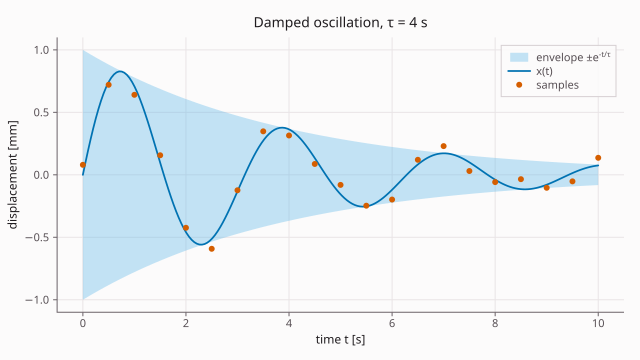
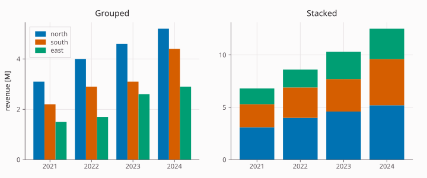
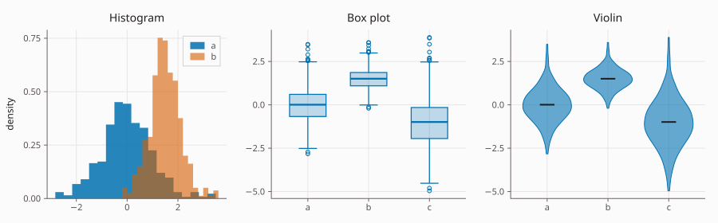
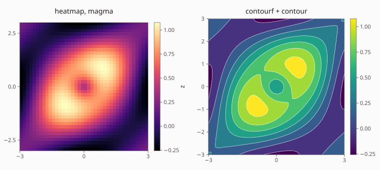
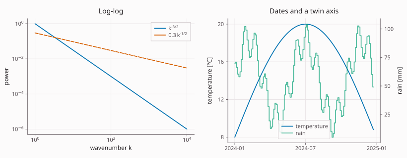

# plot

[](https://github.com/nabi-lang/plot/actions/workflows/ci.yml) [](https://packages.nabi-lang.org/packages/plot) [](#license)

Scientific plotting for Nabi, in pure Nabi: a declarative figure model
(figure, panels, layers) built with method chains, rendered to SVG (exact
text, small files, embeddable in pages and notebooks), to PNG (its own
anti-aliasing rasterizer, built-in font and PNG encoder) and to the terminal
(Unicode braille and blocks, for a quick look in the REPL). Line, scatter,
bars, histograms, steps, areas, error bars, box and violin plots, heatmaps,
contours and vector fields, on linear, log, symlog and date axes, with nice
ticks, published colormaps and light and dark themes that match the Nabi
docs site.



## Add it

```sh
nabi add plot
```

Needs Nabi 0.1 or later. No C libraries and no fonts on the system: every
target works, wasm included.

## Usage

```nabi
let t = plot::linspace(0.0, 10.0, 200);
let y: List<f64> = t.iter().map(|v| (-v / 4.0).exp() * (2.0 * v).sin()).collect();

let ax = plot::axes()
    .line(t, y).label("$x(t)$")
    .hline(0.0).dash(plot::Dash::Dotted)
    .xlabel("time $t$ [s]").ylabel("displacement [mm]")
    .title("Damped oscillation, $\\tau = 4$ s");

let svg = try ax.svg();                 // a String of SVG
let png = try ax.png(scale: 2.0);       // PNG bytes, 2x for HiDPI
println(try ax.term(cols: 72, rows: 20));
// try ax.save("oscillation.svg");     // or .png
```

Layer methods (`line`, `scatter`, `bar`, `hist`, `heatmap`, ...) add a layer;
style methods (`label`, `color`, `width`, `dash`, `marker`, `alpha`, `size`,
`cmap`) change the last one; axis methods (`xlabel`, `xlim`, `xscale`,
`log`, `dates`, `xformat`, `xticks`, `right`, `legend`, `colorbar`, `theme`)
change the panel. Each returns a new Axes, so a chain reads top to bottom.
Every layer type also has a one-call form that starts a panel:
`plot::scatter(x, y)`, `plot::hist(data)`, `plot::heatmap(z)`.

Panels combine with operators: `+` overlays, `|` puts side by side and `/`
stacks, as R's patchwork does. A `Figure` sets the size, a title over all
panels and the theme:

```nabi
let x = plot::linspace(0.0, 6.28, 100);
let s = plot::line(x, x.iter().map(|v| v.sin()).collect::<List<f64>>()).title("sin");
let c = plot::line(x, x.iter().map(|v| v.cos()).collect::<List<f64>>()).title("cos");
let h = plot::hist(x.iter().map(|v| v.sin()).collect::<List<f64>>()).title("values of sin");
let fig = ((s | c) / h).title("Three panels").size(720.0, 480.0).theme(plot::Theme::dark());
assert(fig.panels().len() == 3);
```





Data is a `List` or a `core::array` array of any rank (`f64`, `f32`,
`i64`, `i32`), or an integer range; grids for heatmaps and contours are
`Matrix` arrays or lists of rows. Values are copied when a layer is made.
Pipes read well for one-liners, and `plot!` is the shortest form:

```nabi
let data = [2.1, 3.7, 1.2, 5.5, 4.4, 4.9, 3.3, 2.8, 6.1];
let svg = try data |> plot::hist() |> plot::svg();
let quick = plot::plot!(plot::linspace(0.0, 1.0, 11), [0, 1, 4, 9, 16, 25, 36, 49, 64, 81, 100]);
assert(svg.contains("</svg>") && quick.len() == 1);
```





## What is in it

| Area | Contents |
|---|---|
| Layers | `line`, `line_y`, `step` (`StepAt::Pre`, `Post`, `Mid`), `scatter` (+ `sizes`, `values` with a colormap), `bar`, `bar_at`, `barh`, `bars` (grouped or `stacked`), `hist` (`Bins`: NumPy's rules, `density`), `area`, `fill_between`, `errorbar`, `errorbar_xy`, `boxplot`, `violin`, `heatmap`, `imshow`, `contour`, `contourf`, `quiver`, `text`, `annotate`, `hline`, `vline`, `hspan`, `vspan` |
| Axes | `Scale::Linear`, `Log(base)`, `Symlog { base, linthresh }`, `Date`; limits, inverted axes, fixed ticks, minor ticks, grids, aspect ratio, a twin y axis (`right()`), legends (`Loc::Best` places it where it covers the fewest points), colorbars, titles |
| Ticks | `ticks::extended` (Talbot, Lin and Hanrahan's extension of Wilkinson's algorithm, as R's `labeling`), decades and 1-2-5 steps on log axes, calendar units on date axes; `Format::Auto` (shared `x10^k` offsets, powers of the base), `Fixed`, `Sci`, `Si`, `Percent`, `Custom` |
| Colour | `Colormap::viridis`, `magma`, `inferno`, `plasma`, `cividis` (the published 256-entry tables), `coolwarm` (Moreland), `gray`, reversed with `_r`, or `from_colors`; `Color::parse` (`#rrggbb`, names, `C0`..`C9`); cycles `color::okabe_ito` (default, colour-blind safe) and `tableau10` |
| Themes | `Theme::light()` and `dark()` with the docs site's tokens, `transparent()`, every field public |
| Text | `$..$` math in any label: Greek and symbol commands (`\alpha`, `\times`, `\leq`, `\partial`, ...), superscripts and subscripts (`x^2`, `x_{ij}`, nested), `\mathrm{..}`; set upright in the built-in font |
| Output | `svg`, `png(scale:)`, `term(cols:, rows:, color:)`, `save(path)`, `show()`; `Figure::scene()` for the drawing primitives; `raster::render` for an RGBA image |
| Operators | `+` (overlay), `\|` (side by side), `/` (stacked), `↦` in `ops` (`"date" ↦ "price"`, x first) |
| `frame` | with the `table` feature: plot `table::Table` columns by name, `t \|> plot::frame::scatter("x" ↦ "y", by: "group")`, `line`, `lines`, `hist`, `bar`, `boxplot`; date columns get a date axis |

## Tables

With the `table` feature, columns plot by name and `↦` names them as the
function they draw:

```sh
nabi add plot --features table
```

```nabi ignore
use plot::ops::MapsTo;

let t = try table::read_csv("prices.csv");
let ax = try t |> plot::frame::line("date" ↦ "close", by: "ticker");
try ax.ylabel("close [USD]").save("prices.svg");
```

## Notebooks

A cell whose value is a `Figure` or `Axes` shows the plot in a notebook:
both implement `RichDisplay`, so the Nabi Jupyter kernel sends the SVG (with
a PNG and a text rendering for other front ends). `display(fig)` shows one
mid-cell. In the REPL, `fig.show()` draws the figure in the terminal.

## Output and speed

SVG output is deterministic: on one platform, equal figures give equal
bytes, so SVGs can be checked in and diffed. Coordinates have two decimals.
Across platforms the bytes can differ: the math library (`log`, `exp`,
`sin`, `**`) may round the last bit differently, and that bit can move a
tick, or a coordinate across a 0.01 step, most visibly for data that
is mostly rounding error, such as a 1e-11 energy drift. Text stays text in Geist when
the page has it. PNG output fills paths by exact area coverage,
so every edge is anti-aliased; text uses Geist Regular's outlines (with
Greek and mathematical symbols from Pretendard), embedded in the package
under the SIL Open Font License (`assets/fonts`). The encoder writes RGB or
RGBA with per-row filters and its own DEFLATE.

On an Apple M-series core (`nabi bench`): a 100,000-point line to SVG in
9 ms, a 1,000,000-point scatter to an 800 x 600 PNG in 140 ms, a
1000 x 1000 heatmap to PNG in 104 ms and to SVG (embedded PNG) in 145 ms.

## Example images

The images in this README are made by `nabi run tools/gallery` from the
repository root, which writes `assets/*.svg`.

## Docs

https://docs.nabi-lang.org/packages/plot/latest

## License

Licensed under either of [MIT](LICENSE-MIT) or [Apache-2.0](LICENSE-APACHE), at
your option. The embedded font data comes from Geist and Pretendard, under the
SIL Open Font License 1.1 (`assets/fonts`); [NOTICE](NOTICE) lists the
sources of the font and colormap data.
